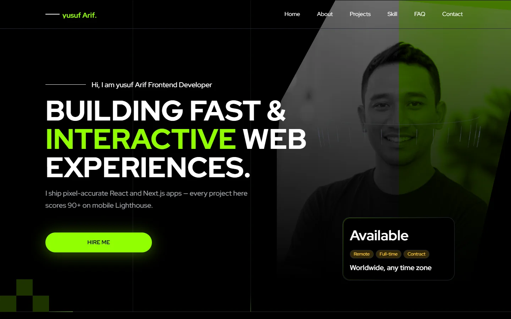
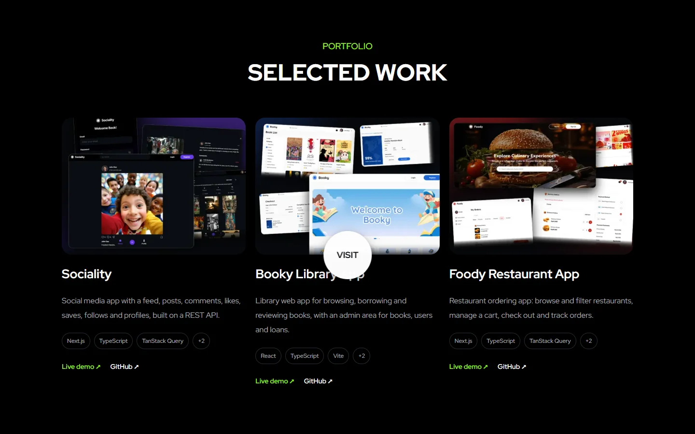
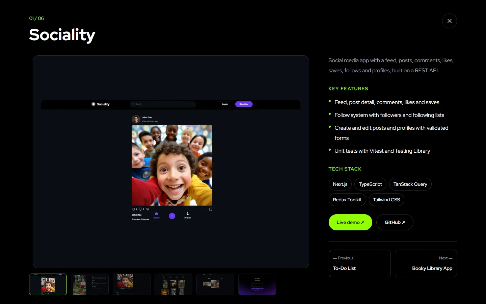
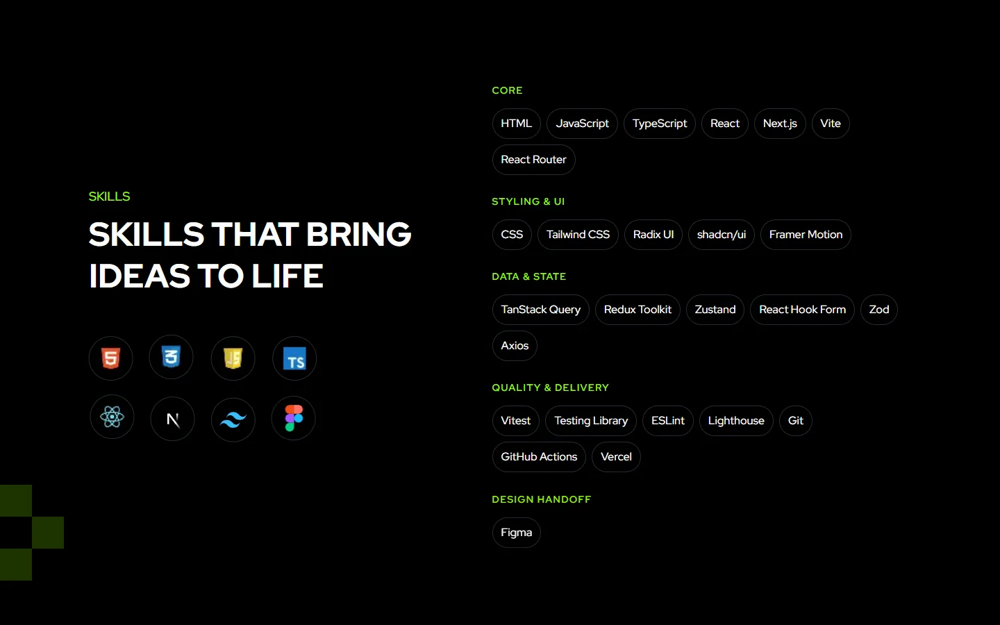
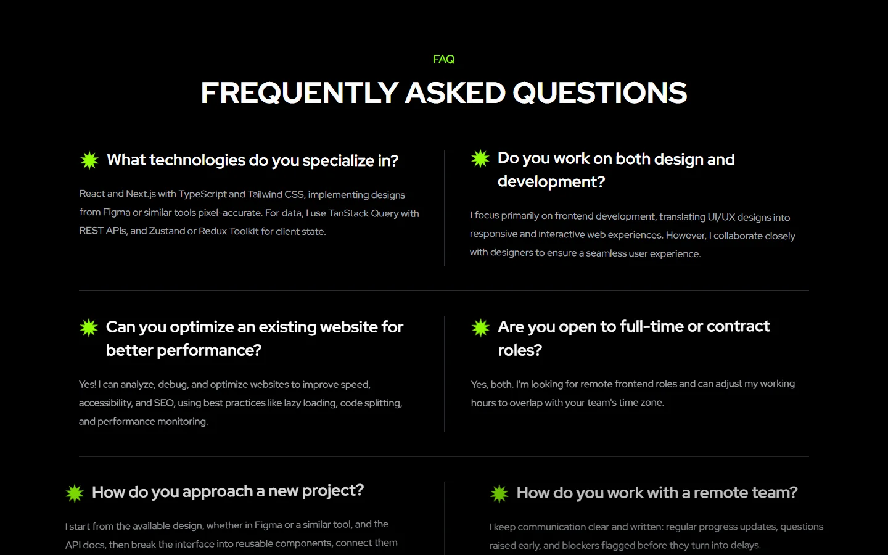
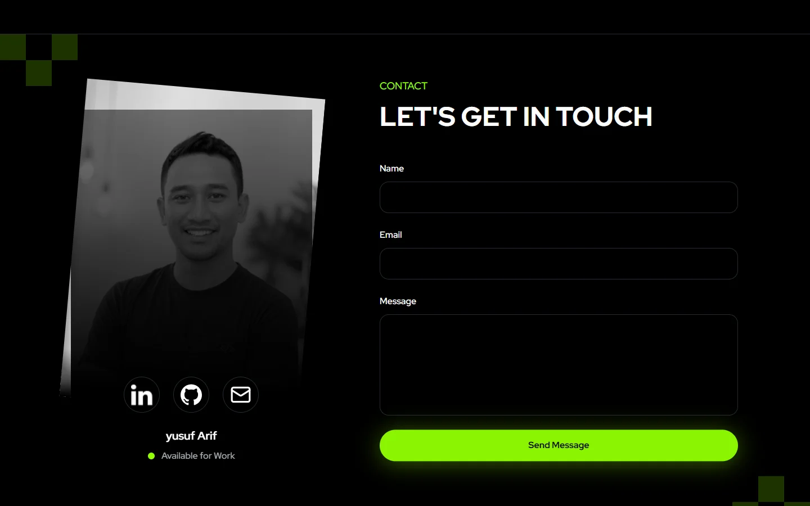

# yusuf Arif — Frontend Developer Portfolio

[](https://github.com/Yusuf-98/Portfolio-yusuf-Arif/actions/workflows/ci.yml)

My personal portfolio: who I am, the projects I have shipped, the stack I work with and how to reach me. Each project opens in a detail view with a screenshot gallery, key features, tech stack and links to the live demo and source code.

Built with Next.js, TypeScript, Tailwind CSS and Framer Motion.

🚀 **Live site:** https://yusuf-arif.vercel.app

<p align="center">
  
</p>

[](#performance)


## Features

- **Hero**: typewriter role rotation and a photo reveal that follows the cursor on desktop; on touch screens a tap locks the reveal in place.
- **Projects**: some of my live projects in a responsive grid. A card opens a detail dialog with a screenshot gallery, key features, tech stack, live demo and GitHub links, and previous/next navigation. A second dialog lists every project in one compact view.
- **Accessible dialogs**: both dialogs are built on Radix Dialog, so focus is trapped inside, returns to the card that opened it, Escape closes it and the page behind does not scroll.
- **Skills**: floating tech icons plus the full stack grouped by area (core, styling and UI, data and state, quality and delivery, design handoff).
- **Why choose me and journey**: a two-column comparison that slides in with the scroll and stays pinned while the career timeline scrolls in beneath it.
- **FAQ**: a two-column grid on desktop and an accordion on mobile, with real buttons and `aria-expanded` so it works by touch, keyboard and screen reader.
- **Contact**: a validated form that delivers messages by email through [Web3Forms](https://web3forms.com), with success and error states. Social links point to LinkedIn, GitHub and email; the email address is only assembled when the link is clicked, which keeps it out of the page source.
- **Sharing**: an Open Graph image and description for link previews on LinkedIn and other platforms.

## Screenshots

| | |
| --- | --- |
|  |  |
| **Projects** — some of my live projects | **Project detail** — gallery, features, stack and links |
|  |  |
| **Skills** — icons and grouped stack | **FAQ** |



## Tech stack

- **Next.js 16** (App Router) + **React 19** + **TypeScript**
- **Tailwind CSS v4** with a custom design token theme
- **Framer Motion** for entrance, scroll-linked and hover animations
- **Radix UI Dialog** for the project dialogs
- **Web3Forms** for contact form delivery
- **Vitest** + **React Testing Library** for tests, **GitHub Actions** for CI
- **ESLint** for linting, **Vercel** for hosting

## Getting started

Requires Node.js 22 or newer.

```bash
git clone https://github.com/Yusuf-98/Portfolio-yusuf-Arif.git
cd Portfolio-yusuf-Arif
npm install
cp .env.example .env.local
```

Fill in the contact form key in `.env.local`:

| Variable | Description |
| --- | --- |
| `NEXT_PUBLIC_WEB3FORMS_KEY` | Access key from [Web3Forms](https://web3forms.com). Without it the site still runs, but the contact form shows its error state. |

Then start the dev server and open `http://localhost:3000`:

```bash
npm run dev
```

| Command | Description |
| --- | --- |
| `npm run dev` | Start the development server |
| `npm run build` | Build for production, then defers the home page's scripts ([defer-next-scripts.mjs](scripts/defer-next-scripts.mjs)) |
| `npm run start` | Serve the production build |
| `npm run lint` | Run ESLint |
| `npx tsc --noEmit` | Type-check only |
| `npm test` | Run the test suite once |
| `npm run test:watch` | Run tests in watch mode |

## Testing

Tests live next to the code they cover (`*.test.tsx`) and run with Vitest and React Testing Library in jsdom. They target interactive logic rather than static markup:

- **Contact form**: required-field and email validation, no request for an invalid form, errors clearing on a click outside the form, the success and failure popups, and the button disabled while a message is sending.
- **Project dialog**: opening the clicked project, moving to the next and previous project, and closing on Escape with focus returning to the card.
- **FAQ accordion**: the answer hidden or shown with the open state, and the toggle on click.

GitHub Actions runs lint, type-check, tests and the production build on every push and pull request ([ci.yml](.github/workflows/ci.yml)).

## Performance

Lighthouse results for the [live site](https://yusuf-arif.vercel.app): the median of 10 mobile and 6 desktop runs on 12 October 2026 (Lighthouse 13.5.0).

| | 📱 Mobile | 🖥️ Desktop |
| --- | :---: | :---: |
| **Performance** | **97** | **100** |
| **Accessibility** | **100** | **100** |
| **Best practices** | **100** | **100** |
| **SEO** | **100** | **100** |

Mobile performance ranged from 94 to 98 across the 10 runs; desktop scored 100 in all 6.

### Core metrics

| Metric | 📱 Mobile | 🖥️ Desktop | Good if |
| --- | :---: | :---: | :---: |
| **First Contentful Paint** (first pixels) | 🟢 1.0 s | 🟢 0.3 s | ≤ 1.8 s |
| **Largest Contentful Paint** (main content visible) | 🟢 1.2 s | 🟢 0.3 s | ≤ 2.5 s |
| **Total Blocking Time** (page unresponsive) | 🟢 186 ms | 🟢 1 ms | ≤ 200 ms |
| **Cumulative Layout Shift** (content jumping) | 🟢 0 | 🟢 0 | ≤ 0.1 |
| **Speed Index** (how fast it fills in) | 🟢 2.6 s | 🟢 0.8 s | ≤ 3.4 s |
| **Page weight** (home page, compressed) | 381 KiB | 416 KiB | |

🟢 within Google's "good" range · figures are medians

### What "mobile" means in this test

The mobile test does not simply run on a fast laptop. Lighthouse slows the machine down to imitate a mid-range phone on a weak connection:

- **Device**: a Moto G Power (2022), 412 × 823 px screen at 1.75× pixel density.
- **Network**: simulated slow 4G, about **1.6 Mbps** download with **150 ms** of round-trip latency.
- **CPU**: slowed down **4×**, so JavaScript takes four times as long to run as it does on the laptop.

The desktop test uses a 1350 × 940 px screen, 10 Mbps, 40 ms latency and no CPU slowdown.

Run it yourself with `npx lighthouse https://yusuf-arif.vercel.app --form-factor=mobile`. A single run can move by a few points with network conditions, which is why the figures above are medians.

### How it stays fast

- **Scripts after the first paint**: a post-build step ([scripts/defer-next-scripts.mjs](scripts/defer-next-scripts.mjs)) rewrites the prerendered page so the Next.js chunks are requested only after the headline has painted, instead of competing with it for bandwidth. It changes the HTML only if it matches the expected shape, and CI fails if the step stops being applied.
- **Only the navbar and hero render at load**: every section below the hero is in the server HTML (so search engines still read it) but stays hidden and is rendered on the client only when it comes within 600 px of the viewport. Navigation links reveal the sections first, so anchors still land exactly.
- **Font**: Red Hat Display is self-hosted through `next/font` with a plain `sans-serif` fallback, which keeps the first layout of the hero text short.
- **Hero photo**: separate WebP files for mobile and desktop, and only the one that matches the screen is loaded; the grayscale layer is a CSS filter rather than pixel work in JavaScript.
- **Animation**: the helm wireframe animates with CSS keyframes instead of re-rendering React every frame, and decorative loops (floating buttons, glowing corners) only run within 200 px of the viewport.

## Project structure

```
app/                  # Root layout, metadata, page and Open Graph image
components/
├── hero/             # Photo reveal and typewriter logic
├── layout/           # Navbar, footer, container
├── portfolio/        # Project card, detail dialog and project list dialog
├── sections/         # One component per page section
├── service/          # Expertise cards
├── ui/               # Buttons, form fields, FAQ items and other primitives
└── work/             # Journey timeline
lib/
├── animations/       # Shared Framer Motion variants and effects
└── data/             # Project data (copy, gallery, stack, links)
public/               # Images, icons and project screenshots
scripts/              # Post-build step that defers the home page's scripts
docs/screenshots/     # Images used in this README
```

Project content lives in [lib/data/projects.ts](lib/data/projects.ts), so adding or editing a project does not touch any component.

## Deployment

Deployed on Vercel from the `main` branch. Set `NEXT_PUBLIC_WEB3FORMS_KEY` in the Vercel project's environment variables; it is read at build time, so redeploy after changing it.

## Author

Built by [Yusuf Arif Rahman](https://www.linkedin.com/in/yusuf-ar/) · [GitHub](https://github.com/Yusuf-98)

## License

The code is licensed under the [MIT License](LICENSE). Personal photos and project screenshots are not covered by the license.
